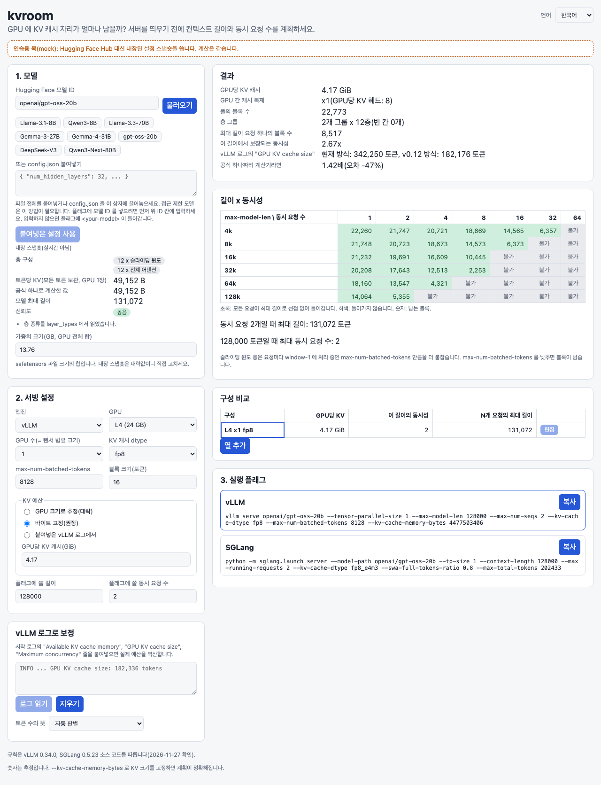
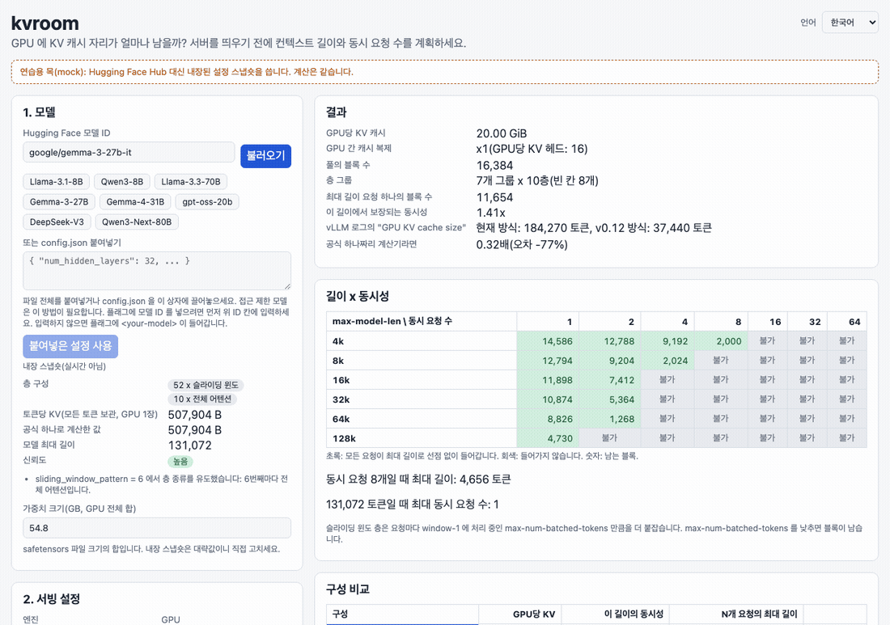
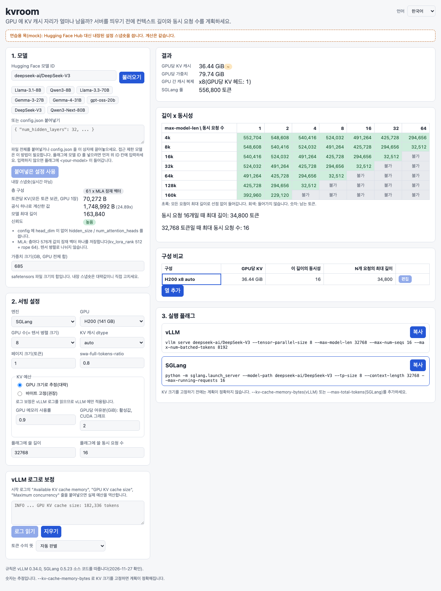
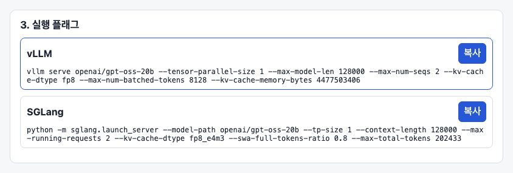
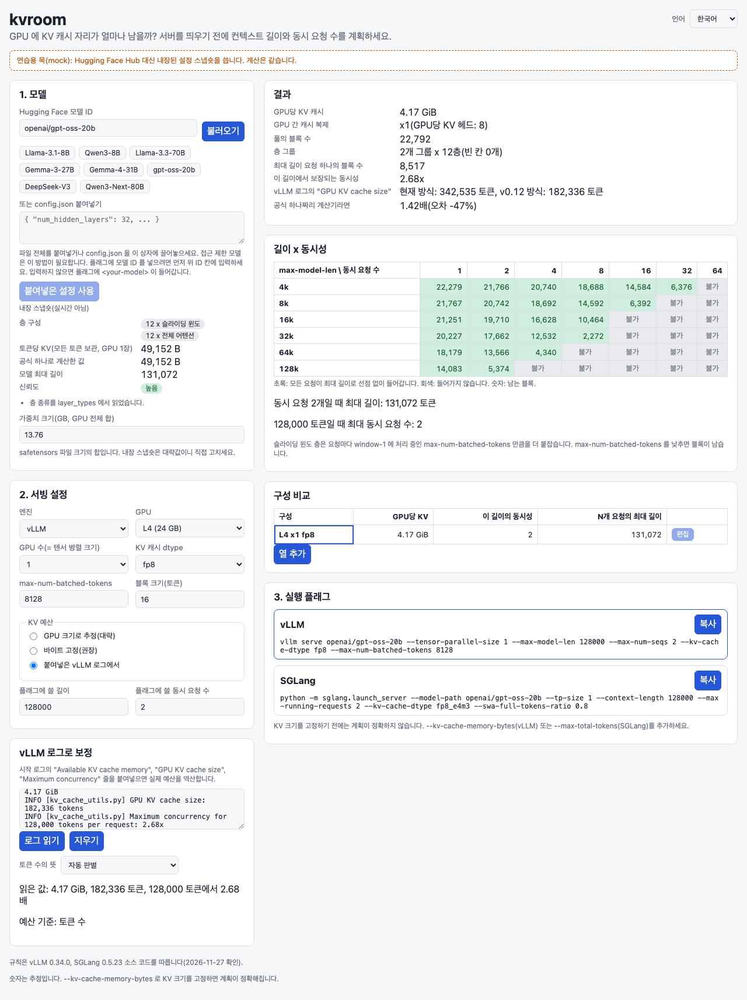
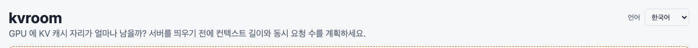
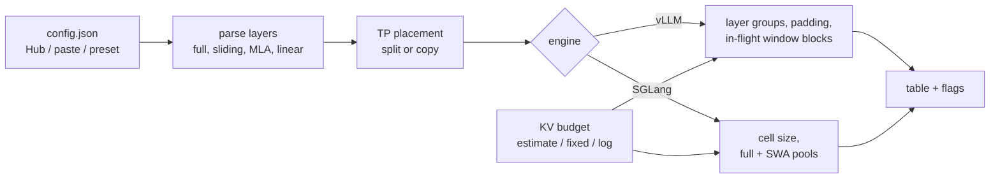

# kvroom

[English](README.md) | **한국어**

kvroom 은 GPU 를 빌리거나 vLLM·SGLang 을 띄우기 전에, 오픈 LLM 을 올릴 GPU 구성에 KV 캐시 공간이 얼마나 있는지 알려 주는 브라우저 앱입니다. 모델의 `config.json` 을 읽어 엔진이 쓰는 블록 계산 규칙을 적용하고, 컨텍스트 길이 x 동시 요청 수 표를 보여 주며, `vllm serve` / `sglang.launch_server` 플래그를 만들어 줍니다. `npm install && npm run dev` 로 실행하며 API 키도 GPU 도 필요 없습니다.


*gpt-oss-20b, L4 한 장, fp8 KV 캐시: 층 구성·결과 패널·길이 x 동시성 표·실행 플래그를 한 화면에 보여 줍니다.*

## 이런 분께
- 오픈 모델을 직접 서빙할 계획이고, GPU 를 빌리기 전에 `--max-model-len` 과 `--max-num-seqs` 를 정해야 하는 분.
- 서버를 띄웠더니 메모리가 부족하거나 요청이 계속 선점(preemption)되어 이유를 알고 싶은 분.
- 모델이 여러 종류의 층(슬라이딩 윈도·전체 어텐션·MLA·선형)을 섞어 쓰는데, "KV 캐시 = 2 x 층 수 x 헤드 수 x ..." 식 계산기의 값이 서버 로그와 맞지 않는 분.

## 설치
Node.js 22.18 이상과 git 이 필요합니다. macOS: `brew install node`. Debian/Ubuntu: `sudo apt-get install -y nodejs npm git` (`node --version` 으로 확인하고, 패키지 버전이 22.18 보다 낮으면 [nodejs.org](https://nodejs.org/) 에서 받으세요).

```bash
git clone https://github.com/LeeGyeongPil/kvroom.git
cd kvroom
npm install
```

## 빠르게 시작하기
```bash
npm run dev
```
```text
> kvroom@0.1.0 dev
> vite

  VITE v8.4.0  ready in 779 ms

  ➜  Local:   http://localhost:5173/
```
(5173 포트가 사용 중이거나 `-- --port <n>` 을 주면 다른 포트가 쓰입니다.) 주소를 열면 내장 모델이 바로 로드되어 숫자가 보입니다.

1. **1. 모델** 에서 내장 모델, `openai/gpt-oss-20b` 같은 Hugging Face 모델 ID, 또는 붙여 넣은 `config.json` 중 하나를 고릅니다. 붙여 넣은 config 의 구조가 이전에 불러온 모델과 다르면 새 모델로 봅니다. 가중치 크기는 0 으로 돌아가고 플래그에는 `<your-model>` 이 들어갑니다. 단, 마지막으로 불러온 뒤 ID 칸에 새 `owner/name` ID 를 직접 입력했다면 그 ID 를 씁니다(붙여 넣기 전에 입력하세요). 붙여 넣기에는 가중치 크기가 없으니 가중치 크기 칸에 직접 입력하세요. 모델이 바뀌면 이전 모델용으로 붙여 넣은 vLLM 로그 값도 지워지고 안내가 뜹니다. 같은 구조의 config 를 다시 붙여 넣으면 ID·가중치·로그가 그대로 남습니다.
2. **2. 서빙 설정** 에서 엔진, GPU, GPU 수, KV 캐시 dtype 을 고릅니다.
3. **결과** 와 표를 읽고, **3. 실행 플래그** 에서 플래그를 복사합니다.

어디서나 올릴 수 있는 정적 파일은 `npm run build` 로 만듭니다(`dist/`). 사이트가 하위 경로에 있으면 먼저 `VITE_BASE=/kvroom/` 를 지정하세요. 레포에는 이 과정을 하는 GitHub Pages 워크플로(`.github/workflows/pages.yml`)가 있습니다.

## 사용법
### 결과 읽는 법
| 줄 | 뜻 |
|---|---|
| GPU당 KV 캐시 | 각 GPU 의 캐시 메모리. `~` 배지는 GPU 크기로 추정한 값이라는 표시입니다. |
| 층 그룹 | vLLM 은 같은 종류의 층끼리 묶어 저장합니다. 개수가 다르면 그룹을 채우려고 빈 칸을 넣어 공간이 낭비됩니다. |
| 최대 길이 요청 하나의 블록 수 | 고른 길이의 요청 하나가 차지하는 캐시 블록 수. |
| 이 길이에서 보장되는 동시성 | 선점 없이 끝까지 들어가는 해당 길이 요청 수. 평균이 아니라 최악의 경우입니다. |
| 공식 하나짜리 계산기라면 | 같은 구성을 밀집 공식 하나로 계산한 값. 얼마나 틀리는지 보여 줍니다. |

표의 칸은 모든 요청이 선점 없이 끝까지 들어가면 초록, 아니면 회색이고, 숫자는 남는 블록(vLLM) 또는 토큰(SGLang)입니다.

### 시나리오 1: 슬라이딩 윈도 모델은 길이와 배치 크기를 맞바꿉니다
Gemma-3-27B 는 슬라이딩 윈도 층 52개와 전체 어텐션 층 10개입니다. 슬라이딩 윈도 층은 `window - 1` 에 지금 처리 중인 배치의 토큰까지 붙잡아 둡니다. 그래서 `max-num-batched-tokens` 가 들어가는 요청 수를 바꿉니다.


*Gemma-3-27B, GPU당 KV 20 GiB, 동시 요청 8개. `max-num-batched-tokens` 를 8192 에서 2048 로 바꾸면 "동시 요청 8개일 때 가능한 최대 길이" 줄이 바뀝니다.*

앱에서 나온 숫자(입력: `?preset=gemma-3-27b&gpu=H100%2080GB&kvgib=20&len=131072&seqs=8`):

| `max-num-batched-tokens` | 층 그룹 | 128k 요청당 블록 | 128k 에서 보장되는 동시성 | 요청 8개일 때 최대 길이 |
|---|---|---|---|---|
| 8192 | 10층 x 7그룹 (빈 칸 8개) | 11,654 | 1.41x | 4,656 토큰 |
| 2048 | 10층 x 7그룹 (빈 칸 8개) | 9,350 | 1.75x | 14,240 토큰 |

같은 모델을 공식 하나로 계산하면 0.32x 로, 엔진 규칙보다 77~82% 낮게 나옵니다.

### 시나리오 2: MLA 와 텐서 병렬
DeepSeek-V3 는 층마다 압축된(잠재, latent) 벡터 하나를 저장하며 bf16 에서 토큰당 70,272 바이트입니다. 공식 하나짜리 추정은 1,748,992 바이트로 24.89배 큽니다. 텐서 병렬(TP)은 잠재 벡터를 나누지 못하므로 GPU 마다 전체 사본을 가집니다.


*DeepSeek-V3, SGLang, H200 8장: MLA 잠재 벡터를 모든 GPU 에 보관(`x8`), SGLang 토큰 풀 하나, 공식 하나로 계산한 값과의 비교(24.89x), 표.*

### 시나리오 3: 플래그 복사

*엔진마다 명령 하나. 고른 엔진이 강조됩니다. 플래그와 dtype 이름은 엔진마다 다릅니다(`fp8` 대 `fp8_e4m3`).*

대조 B 구성에서 앱이 출력하는 명령:

```text
vllm serve openai/gpt-oss-20b --tensor-parallel-size 1 --max-model-len 128000 --max-num-seqs 2 --kv-cache-dtype fp8 --max-num-batched-tokens 8128
python -m sglang.launch_server --model-path openai/gpt-oss-20b --tp-size 1 --context-length 128000 --max-running-requests 2 --kv-cache-dtype fp8_e4m3 --swa-full-tokens-ratio 0.8
```

KV 예산을 고정 숫자로 주면 vLLM 명령에 `--kv-cache-memory-bytes <바이트>` 도 붙습니다. 이 값을 고정해야 계획이 정확해집니다. 추정 모드는 vLLM 이 시작할 때 남은 메모리를 재는 방식에 따라 흔들립니다.

### 시나리오 4: 시작 로그로 보정
vLLM 의 `Available KV cache memory`, `GPU KV cache size`, `Maximum concurrency` 줄을 **vLLM 로그로 보정** 칸에 붙여 넣고 **로그 읽기** 를 누릅니다. kvroom 은 이 줄들에서 실제 예산을 거꾸로 계산하고(블록 수 우선, 그다음 토큰, GiB, 동시성) 표를 다시 그립니다.


*붙여 넣은 시작 로그(gpt-oss-20b, L4 한 장)와 거기서 가져온 예산.*

`GPU KV cache size` 줄의 뜻은 vLLM 버전마다 다릅니다(v0.12: `블록 수 // 그룹 수 x 블록 크기`, 최근: 동시성 x 길이). "토큰 수의 뜻" 메뉴에서 고를 수 있고, `자동 판별` 는 로그의 동시성을 더 잘 재현하는 쪽을 고릅니다.

### 주소로 설정 지정
페이지는 다음 쿼리 매개변수를 읽으므로 설정을 링크로 공유하거나 재현할 수 있습니다: `preset`(`llama-3.1-8b`, `qwen3-8b`, `llama-3.3-70b`, `gemma-3-27b`, `gemma-4-31b`, `gpt-oss-20b`, `deepseek-v3`, `qwen3-next-80b`), `engine`(`vllm`/`sglang`), `gpu`, `tp`, `dtype`, `batched`, `len`, `seqs`, `kvgib`(GPU당 고정 예산, GiB), `lang`(`en`/`ko`).

## 설정
| 변수 | 기본값 | 효과 |
|---|---|---|
| `VITE_KVROOM_OFFLINE` | `0` | `1` 이면 Hugging Face Hub 를 부르지 않고 내장 config 스냅숏을 씁니다. |
| `VITE_BASE` | `/` | 정적 호스팅용 기본 경로. |

둘 다 빌드할 때 정해지는 값입니다(`.env.example` 참고). 키는 필요 없습니다.

### 오프라인 모드

**연습용 목(mock) 모드.** 내장 모델 8개는 Hub 호출을 대신하는 config 스냅숏이라 오프라인에서도 앱이 동작합니다. 로드하면 화면에 배너가 뜹니다. 로드 뒤의 계산은 실제 Hub 모델과 같습니다. 다른 점: 스냅숏은 실제 파일보다 오래됐을 수 있고, 스냅숏의 가중치 크기는 대략값입니다(파라미터 수 x dtype, gpt-oss-20b 만 실제 파일 크기). 가중치 크기 칸을 실제 값으로 고치세요. 실제 Hub 로드에서는 `safetensors` 파일 크기의 합을 씁니다. 접근 제한(gated) 모델은 `config.json` 을 붙여 넣어야 합니다.

### 언어

**화면 언어.** 오른쪽 위 언어 메뉴(English / 한국어)에서 고르며, 선택은 저장됩니다. 처음 방문하면 브라우저 언어로 정합니다(`ko` 로 시작하면 한국어, 아니면 영어). `?lang=ko` 는 둘 다 덮어씁니다.


*언어 메뉴.*

## 동작 원리

- **층 해석**: `config.json` 을 층 종류 목록과, 종류별로 토큰 하나가 차지하는 바이트로 바꿉니다.
- **TP 배치**: KV 헤드는 GPU 수로 나누어떨어지면 나누고, GPU 가 헤드보다 많으면 복사합니다.
- **vLLM**: 같은 종류의 층이 한 그룹을 이루고, 그룹 크기는 가장 적은 종류의 층 수라 다른 종류에는 빈 칸이 생깁니다. 슬라이딩 윈도 층은 요청당 `min(window - 1 + 배치 토큰, 길이)` 토큰에 블록 1개를 더 필요로 합니다.
- **SGLang**: 셀 하나가 토큰 하나의 전 층 캐시를 담고, 슬라이딩 윈도 모델은 전체 풀과 더 작은 윈도 풀을 가집니다.
- **예산**: GPU 크기로 추정(대략), 직접 고정한 숫자, 또는 로그에서 역산.
- `src/core/` 의 계산 코어는 DOM 도 네트워크도 없어서 Node 테스트가 바로 실행합니다.

## 정확도
vLLM 규칙은 vLLM 0.34.0 과 SGLang 0.5.23 의 소스(2026-11-27 확인)를 읽고 다시 구현했습니다. 공개된 시작 로그 두 건을 테스트에서 재현합니다.

| 대조 | 입력 | kvroom | 공개 로그 |
|---|---|---|---|
| A: [vLLM 이슈 12330](https://github.com/vllm-project/vllm/issues/12330) | Llama-3 8B, A100, bf16, 블록 16, 길이 8192, 11.12 GiB | 블록 5,693개, 11.12x | 블록 5,691개, 11.12x |
| B: [DEV 글](https://dev.to/ratibor78/running-openais-gpt-oss-20b-with-128k-context-on-a-single-l4-gpu-27ac) (vLLM v0.12.0) | gpt-oss-20b, fp8, 길이 128,000, 배치 8,128, 4.17 GiB | 182,176 토큰(v0.12 정의), 로그의 블록 22,792개를 넣으면 2.68x | 182,336 토큰, 2.68x |

대조 B 는 공식 하나가 왜 틀리는지도 보여 줍니다. 엔진이 2.68x 라고 알려 주는 구성을 1.42x 로 계산합니다.

## 언제 쓰나
- vLLM·SGLang 용 GPU 를 빌리거나 크기를 정하기 전, 또는 띄운 서버의 숫자가 뜻밖일 때 씁니다.
- 학습용이나 다른 런타임의 가중치+활성값 총량, 또는 코드로 가져다 쓸 수식이 필요하면 다른 도구가 낫습니다. 예: 내 하드웨어의 최종 답은 [vLLM 자체 시작 로그](https://docs.vllm.ai/en/stable/), [gaunernst/kv-cache-calculator](https://huggingface.co/spaces/gaunernst/kv-cache-calculator), [gpu_poor](https://github.com/RahulSChand/gpu_poor). 이들이 무엇을 다루는지는 각 페이지에서 확인하세요. [kvplan](https://pypi.org/project/kvplan/) 은 vLLM 전용 Python 명령줄 도구이고, kvroom 은 브라우저에서 돌며 SGLang 도 다룹니다.

## 한계
- 활성값·CUDA 그래프 메모리는 예측하지 않고 직접 정하는 여유분입니다(기본 GPU당 2 GiB).
- 선형 어텐션 층(Qwen3-Next)과 Gemma 4 전역 층은 "중간(추정)" 신뢰도로 표시됩니다. 엔진의 저장 방식이 버전마다 다릅니다.
- GPU 메모리 크기는 제조사 사양값이고 실제 쓸 수 있는 양은 더 적습니다.
- 규칙은 위 엔진 버전을 따릅니다. 엔진은 바뀌므로 로그 보정 칸으로 내 서버의 시작 로그와 다시 맞춰 보세요.

## 자주 겪는 문제
| 증상 | 원인 | 해결 |
|---|---|---|
| "\"...\" 값을 쓸 수 없습니다: ... 범위로 입력하세요" 와 플래그 없음 | 숫자 칸이 비었거나 0 이거나 범위를 벗어남(블록 크기, 이용률, GiB 등) | 안내문이 알려 주는 범위로 입력하면 플래그가 다시 나옴 |
| 붙여 넣은 config 에 `<your-model>` 이 보이고 가중치 크기가 0 | 이전 모델과 구조가 다른 config 인데, 마지막으로 불러온 뒤 ID 칸에 새 `owner/name` ID 를 입력하지 않음 | ID 칸에 `owner/name` 을 입력하고 다시 붙여 넣은 뒤 가중치 크기를 입력 |
| "다른 모델을 불러와서 이전 모델의 로그 값을 지웠습니다" | 로그 값이 이전 모델 것이었음 | 이 모델의 vLLM 로그를 다시 붙여 넣기 |
| "이 모델은 Hub 에서 접근이 제한되어 있습니다" | 로그인 없이는 Hub 가 config 요청을 거절함 | 모델 페이지에서 약관에 동의한 뒤 `config.json` 을 붙여 넣기 |
| "Hub 에서 ... 모델을 찾지 못했습니다" | ID 가 틀림 | Hub 에 보이는 그대로 `owner/name` 으로 입력 |
| "이 모델의 헤드 64개는 GPU 3장으로 나눌 수 없습니다" | GPU 수는 헤드 수를 나누어떨어뜨려야 함 | 1, 2, 4, 8, 16 중에서 선택 |
| "KV 캐시가 ... 토큰짜리 요청 하나에도 모자랍니다" | KV 캐시가 요청 하나보다 작음 | 길이를 낮추기(안내문이 가능한 최대 길이를 추정해 줌) 또는 메모리 늘리기 |
| "SGLang 이 시작을 거부합니다" | 슬라이딩 윈도 풀이 window + 페이지 크기보다 작음 | KV 캐시에 메모리를 더 주기 |
| KV 크기 옆의 `~` | GPU 크기로 추정한 값 | "고정 바이트"를 고르거나 로그를 붙여 넣기 |
| "내장 스냅숏을 사용합니다" 문구 | Hub 에 접속하지 못함 | 네트워크를 확인하거나 config 를 붙여 넣기 |
| "Found another Vite dev process ... Pass --bypass-lock" | 이 프로젝트의 개발 서버가 이미 실행 중 | 기존 서버를 멈추거나 그 서버의 주소를 열기 |

## 개발·기여
```bash
npm test        # 테스트 82개, node:test, 네트워크 없음
npm run build   # 타입 검사와 정적 빌드
npm run lint
```
버그·제안은 이슈로 남겨 주세요. 변경 기록은 [CHANGELOG.md](CHANGELOG.md). 엔진 규칙이 바뀌면 `src/core/vllm.ts` 또는 `src/core/sglang.ts` 를 고치고 `test/fixtures/logs/` 에 대조 로그를 추가하세요.

## 라이선스
MIT. 블록 규칙은 Apache-2.0 인 [vLLM](https://github.com/vllm-project/vllm) 과 [SGLang](https://github.com/sgl-project/sglang) 의 소스를 읽고 다시 쓴 것이며 코드를 복사하지 않았습니다. 모델 config 스냅숏은 `test/fixtures/README.md` 에 적은 Hugging Face 저장소의 메타데이터이며, 각 모델은 자신의 라이선스를 따릅니다.
