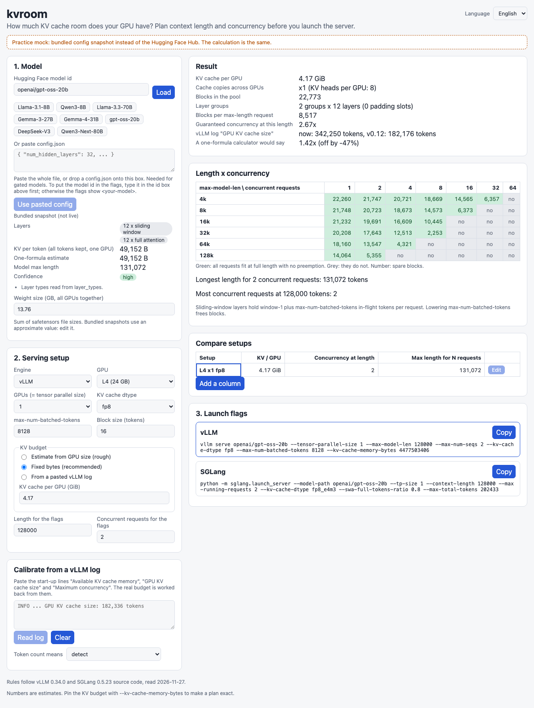
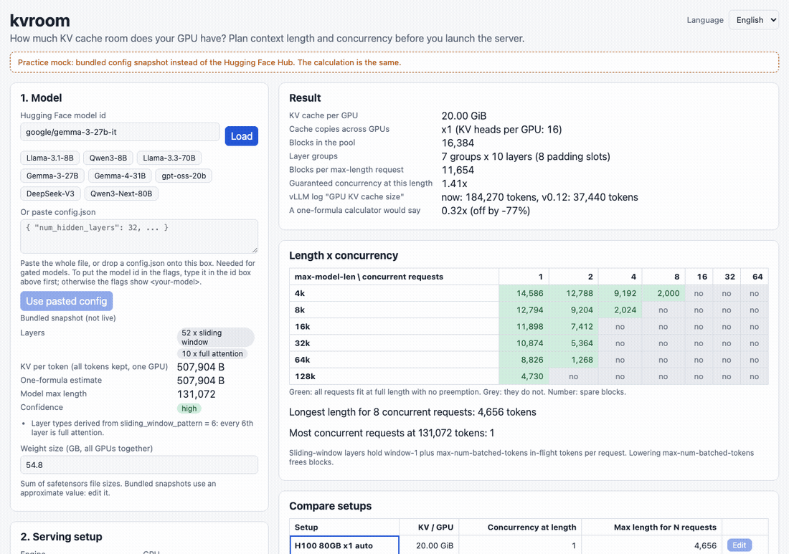
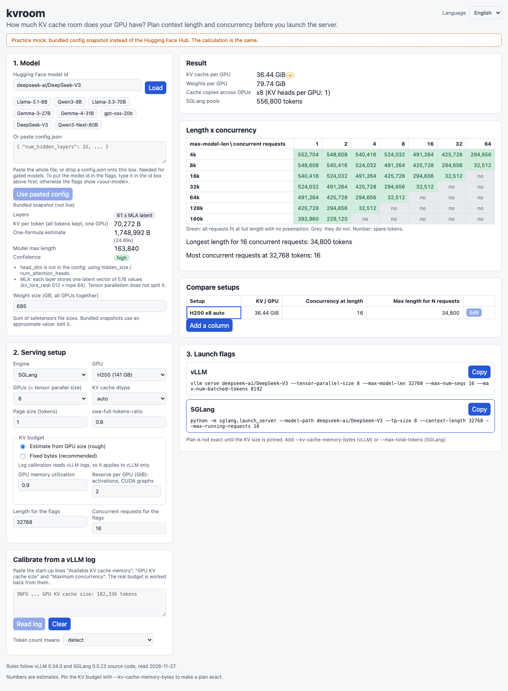
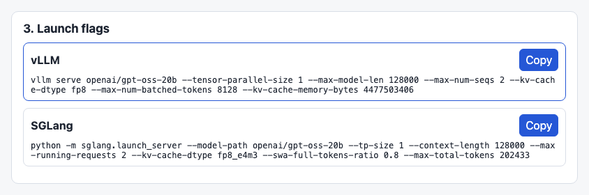
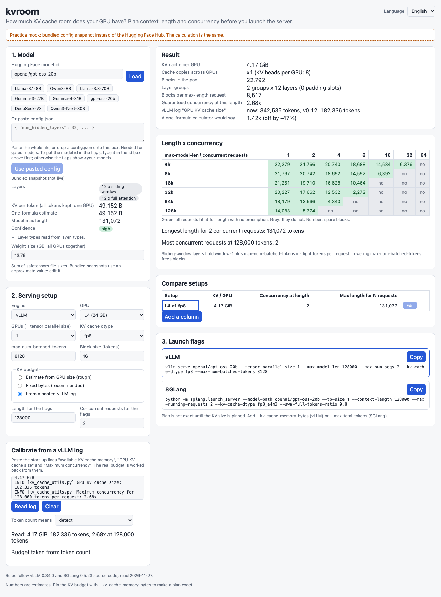
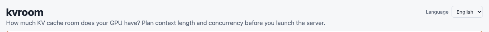
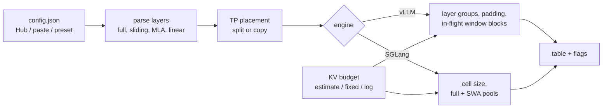

# kvroom

**English** | [한국어](README.ko.md)

kvroom is a browser app that tells you how much KV cache room a GPU setup has for an open LLM, before you rent the GPU or launch vLLM or SGLang. It reads a model's `config.json`, applies the engines' block-counting rules, shows a context length x concurrent requests table, and writes the `vllm serve` / `sglang.launch_server` flags for you. Run it with `npm install && npm run dev`; no API key and no GPU needed.


*gpt-oss-20b on one L4 with fp8 KV cache: the layer split, the result panel, the length x concurrency table and the launch flags on one screen.*

## Who it is for
- You plan to self-host an open model and need to choose `--max-model-len` and `--max-num-seqs` for a given GPU before renting it.
- Your server started, then ran out of memory or kept preempting requests, and you want to know why.
- Your model mixes layer kinds (sliding-window, full, MLA, linear) and a "KV cache = 2 x layers x heads x ..." calculator gives numbers that do not match your server log.

## Install
You need Node.js 22.18 or newer and git. On macOS: `brew install node`. On Debian/Ubuntu: `sudo apt-get install -y nodejs npm git` (check `node --version`; use [nodejs.org](https://nodejs.org/) if the packaged version is older than 22.18).

```bash
git clone https://github.com/LeeGyeongPil/kvroom.git
cd kvroom
npm install
```

## Quick start
```bash
npm run dev
```
```text
> kvroom@0.1.0 dev
> vite

  VITE v8.4.0  ready in 779 ms

  ➜  Local:   http://localhost:5173/
```
(The port is 5173 unless it is busy or you pass `-- --port <n>`.) Open the address. The page loads a built-in model, so numbers appear at once.

1. Pick a model under **1. Model**: a built-in one, a Hugging Face id such as `openai/gpt-oss-20b`, or paste a `config.json`. If the pasted config has a different structure from the model loaded before, kvroom treats it as a new model: the weight size resets to 0 and the flags show `<your-model>`, unless you typed a new `owner/name` id in the id box after the last load (type it before pasting). A paste carries no weight size, so enter it in the weight-size box. A pasted vLLM log from the previous model is cleared when the model changes, with a notice; paste the new model's log again. Re-pasting a config with the same structure keeps the id, weight size and log.
2. Pick engine, GPU, GPU count and KV cache dtype under **2. Serving setup**.
3. Read **Result** and the table, then copy the flags from **3. Launch flags**.

To build static files you can host anywhere: `npm run build` (output in `dist/`). Set `VITE_BASE=/kvroom/` first if the site lives under a sub-path. The repository includes a GitHub Pages workflow (`.github/workflows/pages.yml`) that does this.

## Usage
### Read the result
| Line | Meaning |
|---|---|
| KV cache per GPU | Memory for the cache on each GPU. A `~` badge means it was estimated from GPU size, not pinned. |
| Layer groups | vLLM stores layers of one kind together. When counts differ it pads groups, so some slots are wasted. |
| Blocks per max-length request | How many cache blocks one request of the chosen length holds. |
| Guaranteed concurrency | Requests of that full length that fit with no preemption. This is the worst case, not an average. |
| A one-formula calculator would say | The same setup with one dense formula, to show how far off it is. |

The table colors a cell green when every request fits at full length with no preemption, grey when not; the number is the spare blocks (vLLM) or tokens (SGLang).

### Scenario 1: sliding-window models trade length for batch size
A model such as Gemma-3-27B has 52 sliding-window layers and 10 full-attention layers. Each sliding-window layer keeps `window - 1` plus the tokens of the batch being processed. So `max-num-batched-tokens` changes how many requests fit.


*Gemma-3-27B, 20 GiB KV per GPU, 8 concurrent requests. The "Longest length for 8 concurrent requests" line changes when `max-num-batched-tokens` goes from 8192 to 2048.*

Numbers from the app (input: `?preset=gemma-3-27b&gpu=H100%2080GB&kvgib=20&len=131072&seqs=8`):

| `max-num-batched-tokens` | Layer groups | Blocks per 128k request | Guaranteed concurrency at 128k | Longest length for 8 requests |
|---|---|---|---|---|
| 8192 | 7 groups x 10 layers (8 padding slots) | 11,654 | 1.41x | 4,656 tokens |
| 2048 | 7 groups x 10 layers (8 padding slots) | 9,350 | 1.75x | 14,240 tokens |

The one-formula estimate says 0.32x for the same model, 77% to 82% below the engine's rule.

### Scenario 2: MLA and tensor parallelism
DeepSeek-V3 stores one compressed (latent) vector per layer, 70,272 bytes per token in bf16. The one-formula estimate is 1,748,992 bytes, 24.89x more. Tensor parallelism does not split the latent vector, so every GPU keeps a full copy.


*DeepSeek-V3, SGLang, 8 x H200: the MLA latent kept on every GPU (`x8`), one SGLang token pool, the 24.89x one-formula comparison and the table.*

### Scenario 3: copy the flags

*One command per engine. The active engine is highlighted. Flag and dtype names differ between engines (`fp8` vs `fp8_e4m3`).*

For the receipt-B setup the app prints:

```text
vllm serve openai/gpt-oss-20b --tensor-parallel-size 1 --max-model-len 128000 --max-num-seqs 2 --kv-cache-dtype fp8 --max-num-batched-tokens 8128
python -m sglang.launch_server --model-path openai/gpt-oss-20b --tp-size 1 --context-length 128000 --max-running-requests 2 --kv-cache-dtype fp8_e4m3 --swa-full-tokens-ratio 0.8
```

When the KV budget is a fixed number, the vLLM command also carries `--kv-cache-memory-bytes <bytes>`. Pinning it makes the plan exact; the estimate mode depends on how vLLM measures free memory at start-up.

### Scenario 4: calibrate from a start-up log
Paste the vLLM lines `Available KV cache memory`, `GPU KV cache size` and `Maximum concurrency` into **Calibrate from a vLLM log** and press **Read log**. kvroom works the real budget back from them (block count first, then tokens, GiB, concurrency) and redraws the table.


*A pasted start-up log (gpt-oss-20b on one L4) and the budget taken from it.*

The line `GPU KV cache size` means different things in different vLLM versions (v0.12: `blocks // groups x block size`; recent: concurrency x length). The "Token count means" menu lets you pick; `detect` chooses the one that reproduces the logged concurrency better.

### URL settings
The page reads these query parameters, so a setup can be linked or reproduced: `preset` (`llama-3.1-8b`, `qwen3-8b`, `llama-3.3-70b`, `gemma-3-27b`, `gemma-4-31b`, `gpt-oss-20b`, `deepseek-v3`, `qwen3-next-80b`), `engine` (`vllm`/`sglang`), `gpu`, `tp`, `dtype`, `batched`, `len`, `seqs`, `kvgib` (fixed budget in GiB per GPU), `lang` (`en`/`ko`).

## Configuration
| Variable | Default | Effect |
|---|---|---|
| `VITE_KVROOM_OFFLINE` | `0` | `1` never calls the Hugging Face Hub and uses the built-in config snapshots. |
| `VITE_BASE` | `/` | Base path for static hosting. |

Both are build-time values; see `.env.example`. No key is needed.

### Offline mode

**Practice mock mode.** The eight built-in models are config snapshots that stand in for the Hub fetch, so the app works offline. A banner says so when one is loaded. The calculation after loading is the same as for a live Hub model. What differs: the snapshot may be older than the live file, and weight sizes in snapshots are approximate (parameter count x dtype; only gpt-oss-20b uses real file sizes). Edit the weight-size box to your real value. With a live Hub load, weight size is the sum of the `safetensors` file sizes. Gated models need their `config.json` pasted.

### Language

**Screen language.** Use the language menu at the top right (English / 한국어). The choice is saved. On first visit the browser language decides (Korean if it starts with `ko`, else English). `?lang=ko` overrides both.


*The language menu.*

## How it works

- **Parse layers**: `config.json` is turned into a list of layer kinds and the bytes one token costs in each kind.
- **TP placement**: KV heads are split across GPUs when they divide evenly and copied when there are more GPUs than heads.
- **vLLM**: layers of one kind form a group; group size is the smallest kind's layer count, so other kinds get padding slots. A sliding-window layer needs `min(window - 1 + batch tokens, length)` tokens per request plus one block.
- **SGLang**: one cell holds a token's cache for all layers; models with sliding windows get a full pool and a smaller window pool.
- **Budget**: from GPU size (rough), from a number you pin, or worked back from a log.
- The core in `src/core/` has no DOM and no network, so Node tests run it directly.

## Accuracy
The vLLM rules were re-implemented from the source of vLLM 0.34.0 and SGLang 0.5.23 (read 2026-11-27). Two public start-up logs are reproduced in the tests:

| Receipt | Input | kvroom | Public log |
|---|---|---|---|
| A: [vLLM issue 12330](https://github.com/vllm-project/vllm/issues/12330) | Llama-3 8B, A100, bf16, block 16, length 8192, 11.12 GiB | 5,693 blocks, 11.12x | 5,691 blocks, 11.12x |
| B: [DEV post](https://dev.to/ratibor78/running-openais-gpt-oss-20b-with-128k-context-on-a-single-l4-gpu-27ac) (vLLM v0.12.0) | gpt-oss-20b, fp8, length 128,000, batched 8,128, 4.17 GiB | 182,176 tokens (v0.12 definition); 2.68x with the logged 22,792 blocks | 182,336 tokens; 2.68x |

Receipt B also shows why one dense formula fails: it gives 1.42x for a setup the engine reports as 2.68x.

## When to use it
- Use it before renting or sizing GPUs for vLLM or SGLang, or when a started server's numbers surprise you.
- Use another tool when you need weights-plus-activations totals for training or for other runtimes, or a ready-made formula in code. Examples: [vLLM's own start-up log](https://docs.vllm.ai/en/stable/) for the final truth on your hardware, [gaunernst/kv-cache-calculator](https://huggingface.co/spaces/gaunernst/kv-cache-calculator), [gpu_poor](https://github.com/RahulSChand/gpu_poor). Check their pages for what they cover. [kvplan](https://pypi.org/project/kvplan/) is a Python command-line tool for vLLM only; kvroom runs in the browser and also covers SGLang.

## Limits
- Activation and CUDA-graph memory are a reserve you set (default 2 GiB per GPU), not predicted.
- Linear-attention layers (Qwen3-Next) and Gemma 4 global layers are marked "medium (estimate)": the engines' storage details vary by version.
- GPU memory sizes are vendor spec values; usable memory is lower.
- Rules follow the engine versions above. Engines change; re-check against your own start-up log with the calibration box.

## Troubleshooting
| Symptom | Cause | Fix |
|---|---|---|
| "The value of \"...\" is not allowed: use ..." and no flags | A number field is empty, 0 or out of range (block size, utilization, GiB and so on) | Enter a value in the range the message names; flags return once it is valid |
| Pasted config shows `<your-model>` and weight size 0 | The config has a different structure from the previous model, and no new `owner/name` id was typed in the id box after the last load | Type the id as `owner/name` in the id box, paste again, then enter the weight size |
| "A different model was loaded, so the log read for the previous model was cleared" | The log values belonged to the previous model | Paste this model's vLLM log again |
| "This model is gated on the Hub" | The Hub refuses the config request without a login | Accept the terms on the model page, then paste its `config.json` |
| "Model ... was not found on the Hub" | Wrong id | Use `owner/name` exactly as on the Hub |
| "The model has 64 heads, which cannot be split across 3 GPUs" | GPU count must divide the head count | Choose 1, 2, 4, 8 or 16 |
| "One request of this length does not fit" | KV cache is smaller than one request | Lower the length (the message estimates the longest one) or add memory |
| "SGLang would refuse to start" | Sliding-window pool smaller than window + page size | Give the KV cache more memory |
| A `~` next to KV size | Estimated from GPU size | Choose "Fixed bytes" or paste a log |
| "Using the bundled snapshot" note | The Hub could not be reached | Check the network, or paste the config |
| "Found another Vite dev process ... Pass --bypass-lock" | A dev server for this project is already running | Stop it, or open the address it already serves |

## Development
```bash
npm test        # 82 tests, node:test, no network
npm run build   # type-check and static build
npm run lint
```
Bugs and ideas are welcome as issues. See [CHANGELOG.md](CHANGELOG.md). When an engine's rule changes, update `src/core/vllm.ts` or `src/core/sglang.ts` and add a receipt under `test/fixtures/logs/`.

## Credits and license
MIT. The block rules were derived by reading the Apache-2.0 sources of [vLLM](https://github.com/vllm-project/vllm) and [SGLang](https://github.com/sgl-project/sglang) and re-writing them; no code was copied. Model config snapshots are metadata from Hugging Face repositories listed in `test/fixtures/README.md`; each model keeps its own license.
